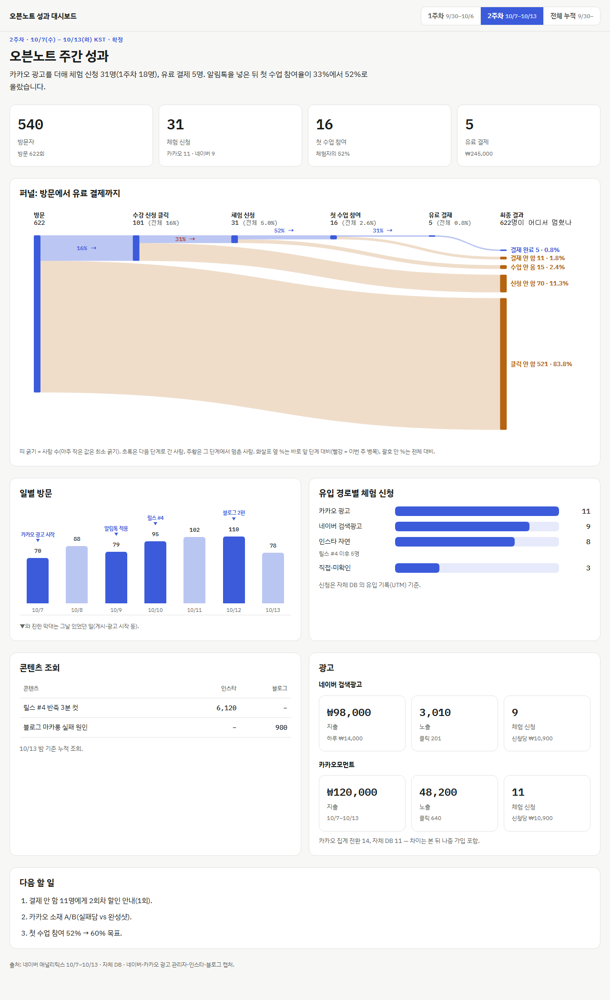

# 주간 성과 보고서 키트

광고·SNS·분석 도구가 사람마다 달라도 **같은 틀**로 매주 성과 대시보드 한 장을 만듭니다.
틀은 고정(퍼널·일별 방문·유입·콘텐츠·광고·다음 할 일), 채널은 처음에 한 번 물어보고 기억합니다.



## 쓰는 법 — 둘 중 하나

### A. Claude Code 플러그인 (매주 쓸 사람)
```
/plugin marketplace add yt-hwang/weekly-report-kit
/plugin install weekly-report@weekly-report-kit
```
그다음 아무 폴더에서 "주간 보고서 만들어줘". 처음엔 쓰는 채널을 묻고 `weekly-report.config.json` 으로 저장, 다음 주부터는 캡처만 주면 됩니다.

### B. 프롬프트만 (claude.ai 대화창에서 한 번 써 보기)
[`PROMPT.md`](PROMPT.md) 의 상자를 복사해 붙이고, [`template.html`](plugins/weekly-report/skills/weekly-report/references/template.html) 을 첨부하세요.

## 들어 있는 것
| 파일 | 내용 |
|---|---|
| `references/template.html` | 레퍼런스 대시보드(가상 견본 '오븐노트'). `REPORT` 객체만 바꾸면 됨 |
| `references/data-schema.md` | `REPORT` 형식 |
| `references/channel-recipes.md` | GA4·네이버·메타·구글·카카오·틱톡·인스타·블로그·스마트스토어 등에서 숫자 가져오는 곳 |
| `references/config.example.json` | 첫 설정 예시 |
| `SKILL.md` | Claude 가 따르는 순서(설정 → 숫자 → 보고서 → 마감) |

## 원칙
- 디자인은 매주 바꾸지 않는다 — 지난주와 나란히 비교되게.
- 퍼널은 실제 사람(내 DB) 기준. 광고 관리자 '전환'은 광고 섹션에 따로, 차이는 메모.
- 숫자가 애매하면 추측하지 않고 묻는다. 개인정보는 싣지 않는다.

만든 곳: [Com2Worship](https://com2worship.com) 팀이 매주 수요일 회의에서 쓰는 보고서를 일반화했습니다.
